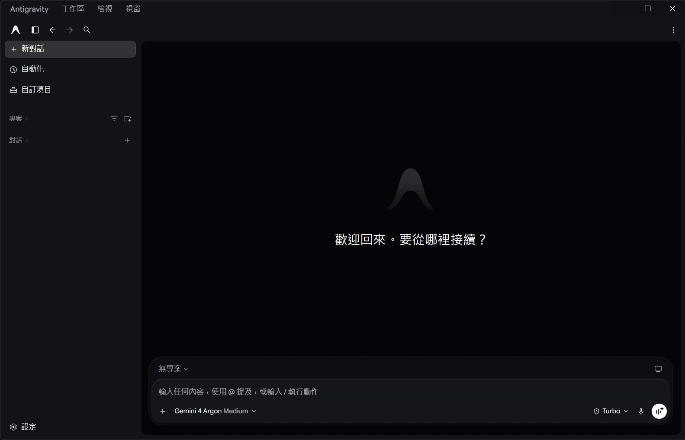
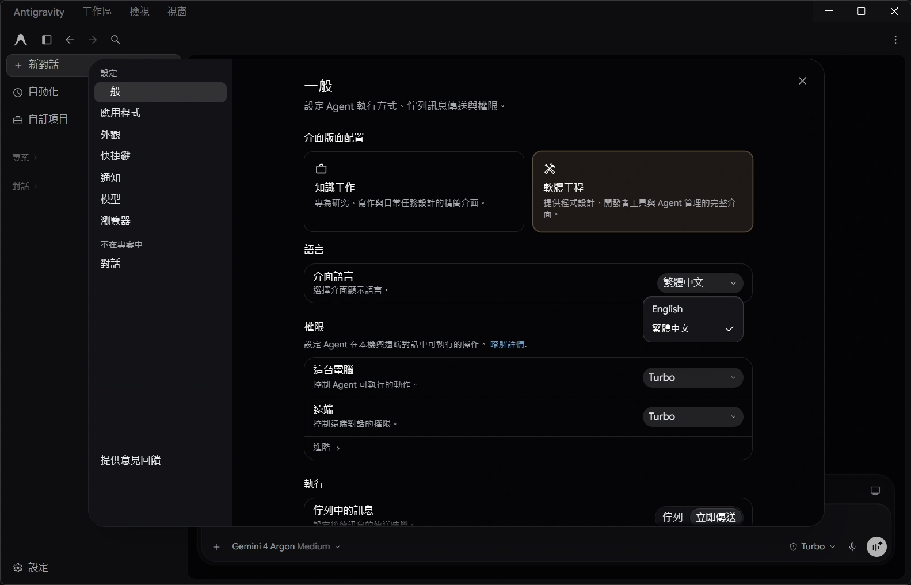

# Antigravity i18n


An unofficial multi-locale UI localization toolkit for Google Antigravity 2.0 Desktop on Windows, with Traditional Chinese (`zh-TW`) included by default. A Python pipeline extracts UI strings from your local installation into JSON dictionaries, while TypeScript Electron hooks switch languages at runtime without altering upstream binaries.

## Features

- Extract native and embedded Web UI strings from `app.asar` and `language_server.exe`, keeping existing non-empty translations.
- Switch between `English` and installed locales without restarting via a dropdown under **Settings -> General** or the **Help -> Display Language** menu.
- Skip code blocks, terminals, and editable inputs while leaving workspace and skill names untranslated.
- Capture unmapped English strings from the window with `Ctrl + Alt + Shift + L` into `dict/missing-ui.json`.
- Back up the original `app.asar` before patching and restore it on demand.

## Screenshots

Main window and menus (`zh-TW`):



Language dropdown injected under **Settings -> General**:



## Requirements

- Windows 10 or 11 (`%LOCALAPPDATA%\Programs\antigravity` by default)
- Python 3.12+ with `uv`
- [Bun](https://bun.sh/) 1.3+

## Setup and run

Apply the included `zh-TW` translation from an external PowerShell window:

```powershell
bun install
bun run build
bun run patch:kill
```

If Antigravity updated or you want to extract strings from your local installation first:

```powershell
uv sync
.venv\Scripts\python.exe -m pipeline
```

Pass `-- --app-dir <path>` to any `bun run` patcher command to target a custom installation directory.

| Command | Purpose |
| --- | --- |
| `.venv\Scripts\python.exe -m pipeline` | Extract UI strings into the default locale folder under `dict/` |
| `.venv\Scripts\python.exe -m pipeline --all-locales` | Refresh all configured locale dictionaries in `dict/` |
| `bun run status` | Check installation path, version, and `app.asar` patch state |
| `bun run patch` | Patch `app.asar` while Antigravity is closed |
| `bun run patch:kill` | Close `Antigravity.exe`, patch `app.asar`, and relaunch |
| `bun run restore` | Restore `app.asar` from backup |

## Adding locales

All locale dictionaries live in `dict/<locale>/` and are registered in [`dict/locales.json`](./dict/locales.json) (the first entry sets the default locale):

```text
dict/
├── locales.json
└── zh-TW/
    ├── icons-ignore.json
    ├── native.json
    ├── webui-exact.json
    └── webui-patterns.json
```

To initialize a new locale (for example `ja`):

```powershell
.venv\Scripts\python.exe -m pipeline --locale ja --label "日本語"
```

Translate `native.json`, `webui-exact.json`, and `webui-patterns.json` inside `dict/<locale>/`, then run `bun run build` and `bun run patch:kill` (pass `-- --locale <id>` to patch static splash HTML with a non-default locale).

## Repository layout

```text
├── dict/
│   ├── locales.json     Locale registry and dropdown labels
│   └── <locale>/        Per-locale JSON dictionaries
├── pipeline/            Python string extractors and dictionary builder
├── src/                 CLI patcher and Electron runtime hooks
├── dist/i18n/           Bundled runtime hooks (`bun run build`, gitignored)
└── LICENSE              MIT License
```

## Notes

- This project is unofficial and includes no Antigravity binaries or modified upstream packages.
- Modifying `app.asar` may violate upstream Terms of Service; use at your own risk.
- When Antigravity updates overwrite `app.asar`, stale backups are blocked automatically. Run `.venv\Scripts\python.exe -m pipeline` against the clean update (existing translations are preserved), then `bun run build` and `bun run patch:kill`.

## License

This project is licensed under the [MIT License](./LICENSE). Copyright © 2026 oF.
