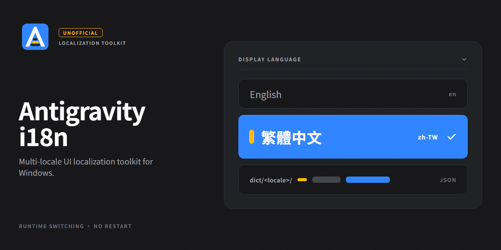

# Antigravity Zh-TW



An unofficial Traditional Chinese (Taiwan) localization toolkit for Google Antigravity 2.0 Desktop on Windows. A Python pipeline extracts UI strings from your local installation into JSON dictionaries, while TypeScript Electron hooks switch languages at runtime without altering upstream binaries.

## Features

- Extract native and embedded Web UI strings from `app.asar` and `language_server.exe`, keeping existing non-empty translations.
- Switch between `English` and installed locales without restarting via a dropdown under **Settings -> General** or the **Help -> Display Language** menu.
- Skip code blocks, terminals, and editable inputs while leaving workspace and skill names untranslated.
- Capture unmapped English strings from the window with `Ctrl + Alt + Shift + L` into `dict/missing-ui.json`.
- Back up the original `app.asar` before patching and restore it on demand.

## Requirements

- Windows 10 or 11 (`%LOCALAPPDATA%\Programs\antigravity` by default)
- Python 3.12+ with `uv`
- [Bun](https://bun.sh/) 1.3+

## Setup and run

```powershell
uv sync
bun install
.venv\Scripts\python.exe -m pipeline
bun run build
```

Close Antigravity before running `bun run patch`, or run `bun run patch:kill` from an external PowerShell window. Pass `--app-dir <path>` to target a custom installation directory.

| Command | Purpose |
| --- | --- |
| `.venv\Scripts\python.exe -m pipeline` | Extract UI strings into `dict/` |
| `bun run patch` | Patch `app.asar` while Antigravity is closed |
| `bun run patch:kill` | Close `Antigravity.exe`, patch `app.asar`, and relaunch |
| `bun run restore` | Restore `app.asar` from backup |

## Adding locales

The dropdown reads [`dict/locales.json`](./dict/locales.json) and scans `dict/<locale>/` folders containing `webui-exact.json`. To add a language, create `dict/<locale>/` with the four dictionary JSON files, add `"<locale>": "<Display Label>"` to `dict/locales.json`, then run `bun run build` and `bun run patch:kill`.

## Repository layout

```text
├── dict/          Locale config and JSON dictionaries
├── pipeline/      Python string extractors and dictionary builder
├── src/           CLI patcher and Electron runtime hooks
├── dist/i18n/     Bundled runtime hooks (`bun run build`, gitignored)
└── LICENSE        MIT License
```

## Notes

- This project is unofficial and includes no Antigravity binaries or modified upstream packages.
- Modifying `app.asar` may violate upstream Terms of Service; use at your own risk.
- When Antigravity updates overwrite `app.asar`, stale backups are blocked automatically; restore before updating or re-run the pipeline on the clean package.

## License

This project is licensed under the [MIT License](./LICENSE). Copyright © 2026 oF.
